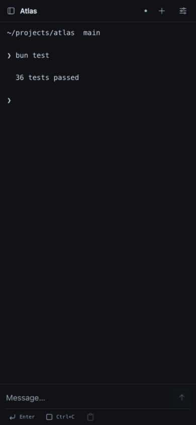

# cmux Remote

Control the cmux terminals on your Mac from a browser over your private Tailscale network.

The Mac runs your tools. This companion gives your phone a small interface for reading
output, switching workspaces, and sending input. It uses cmux's local CLI; it does not
require the official cmux iOS subscription.

## What it does

- Browse workspaces and terminals without changing focus on the Mac.
- Create a workspace or add a terminal tab from the header's plus button.
- Read snapshots with adjustable 6–20 px text and an original-layout view.
- Keep the displayed snapshot still while you scroll through earlier output.
- Submit a line with Enter, insert text without Enter, or send Enter and Ctrl+C.
- Preserve drafts while switching terminals or reconnecting.
- Block further input after an uncertain write until you explicitly recover the terminal.

The interface uses Tabler icons and supports narrow mobile screens. All application-owned
copy is in English. Workspace names and terminal content stay exactly as supplied by cmux.



The screenshot uses synthetic terminal data. [Desktop view](docs/images/desktop.jpg).

## Requirements

For a live host:

- macOS with cmux installed and running. Native integration was tested with cmux 0.64.22.
- Bun; the development and CI version is pinned in `.bun-version`.
- Tailscale on the Mac and phone, using the same Tailscale account.
- Native cmux socket access. The default setup below runs inside a cmux terminal.

For source checks only, cmux and Tailscale are not needed. Tests use fake executables and
temporary loopback listeners.

## Quick start

From a checkout or extracted source archive, open a terminal **inside cmux** and run:

```sh
bun install --frozen-lockfile
bun run build
bun run doctor
bun run start
```

Get the source from [GitHub](https://github.com/malakhov-dmitrii/cmux-remote) or
download a versioned archive from [Releases](https://github.com/malakhov-dmitrii/cmux-remote/releases).

Keep the process running. In a second terminal, expose it privately:

```sh
tailscale serve --bg --https=8443 http://127.0.0.1:49163
```

Tailscale may ask you to enable Serve and HTTPS first. Open the printed remote URL on
your phone with Tailscale connected. In Safari, you can add the page to your Home Screen.

The launcher discovers your Mac's Tailscale address and owner identity. It does not
contain a preconfigured account or hostname. See [configuration](docs/configuration.md)
for ports, executable paths, and recovery-state storage.

## Using the terminal

Choose **+ → New workspace** to open a shell in a new workspace. Name and Directory
are optional; the default directory is your Mac user's home. Directory accepts an
absolute path or `~/…` and must already exist.

Choose **+ → New terminal** to add a tab beside the selected terminal. The remote
opens the new target after creation without selecting it in the Mac app. Previous
terminal drafts stay available when you switch back.

If creation is not confirmed, inspect the session list before trying again: the
workspace or tab may already exist. Creation is never retried automatically.

[Workspace creation preview](docs/images/creation.jpg), using synthetic data.

Select a workspace from the header, then a terminal if it has more than one.
The arrow button sends the text and Enter as one remote operation. The insert button
sends text only. The keys underneath the field send Enter or Ctrl+C.

Display settings control text size and reading mode. **Text** wraps output and removes
box-drawing frames. **Original** keeps the exact snapshot layout. Scrolling back freezes
the shown snapshot; the down-arrow returns to the latest output.

If a write fails or its result is uncertain, inspect the terminal before choosing
**Send Ctrl+C to recover**. Recovery can interrupt a running command. The application
never retries terminal input or performs recovery automatically.

## Limits

The remote reads snapshots of up to 200 lines roughly once a second. Streaming VT
interaction is outside this release. Input accepts one line, up to 8,000 characters. There is no
multiline paste, deletion, split creation, or remote resize control. New terminal
creation is limited to local workspaces; remote SSH/tmux workspaces are unsupported.

Your Mac must remain awake, connected, and logged into its user session. The foreground
bridge stops when its process closes. An optional launchd template is documented in
[background operation](docs/operations.md); installing a template does not remove the
Mac, login, or native cmux access requirements.

The bridge is designed for **Tailscale Serve** and a trusted local machine. Generic
public tunnels and arbitrary authentication proxies are unsupported. Read the
[security model](SECURITY.md) before changing access settings.

## Development

```sh
bun install --frozen-lockfile
bun run check
bun run dev
```

Development uses the same server origin as normal operation. The client rebuilds on
changes; reload the browser to see them. No development proxy bypasses origin validation.

[Contributing](CONTRIBUTING.md) · [Architecture and protocol](docs/architecture.md) ·
[Troubleshooting](docs/troubleshooting.md) · [Release checklist](docs/releasing.md)

## Attribution

Based on [hummer98/cmux-remote](https://github.com/hummer98/cmux-remote), originally by
Yuji Yamamoto. The original MIT notice is preserved in [LICENSE](LICENSE).
This is an independent companion, not an official Manaflow product.

Icons: [Tabler Icons](https://tabler.io/icons), used under MIT. See [NOTICE.md](NOTICE.md)
and [LICENSES/Tabler.txt](LICENSES/Tabler.txt).
